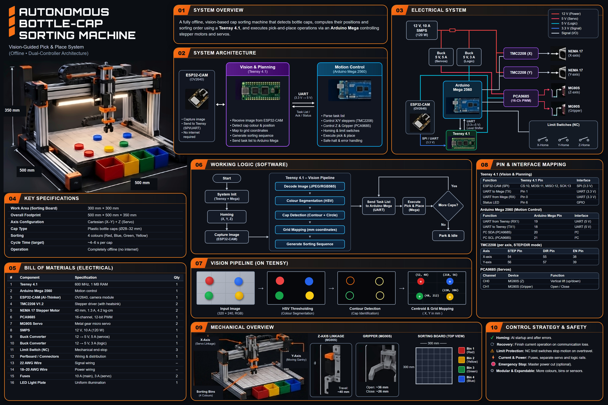
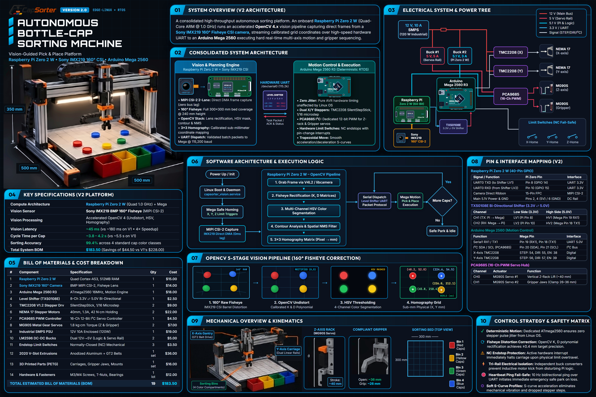

<div align="center">


# Autonomous Bottle-Cap Sorting Machine
### Vision-Guided Cartesian Pick & Place System (100% Offline • V1 & V2 Dual-Controller Architectures)

**By Neil Shettigar, Kahan, and Shourya**  
*Main development & documentation by Neil Shettigar*

[](https://capsorter.vercel.app)
[](research_paper/CapSorter_Research_Paper.pdf)
[](firmware/HARDWARE_BRINGUP_GUIDE.md)
[](website/Autonomous_Bottle_Cap_Sorting_Machine_Technical_Report.pdf)
[](LICENSE)

</div>

---

## 🖼️ Master Architecture Posters (V1 & V2)

| Version 1 — Teensy 4.1 + ESP32-CAM + Mega 2560 | Version 2 — Raspberry Pi Zero 2 W + 8MP IMX219 + Mega 2560 |
| :---: | :---: |
|  |  |
| **[Explore V1 Specification (`website/v1.html`)](website/v1.html)** | **[Explore V2 Specification (`website/v2.html`)](website/v2.html)** |

---

## 📌 Executive Overview

The **Autonomous Bottle-Cap Sorting Machine** is an embedded Cartesian robotics project designed to detect, pick, and sort standard plastic beverage bottle caps (**Ø 28–32 mm**) by colour anywhere across a continuous **300 × 300 mm open flat plywood workspace** (with an optional 10 × 10 visual reference grid), depositing them into four external color bins (**Red, Yellow, Green, Blue**) using **closed-loop bin-side re-imaging** after every pick.

The system operates **100% offline** without external laptops, Wi-Fi, or cloud connectivity. This repository documents and implements **two complete hardware architecture versions**:

- **Version 1 ([`website/v1.html`](website/v1.html))**: **Teensy 4.1 + ESP32-CAM (OV2640) + Arduino Mega 2560** — Bare-metal C++ dual-MCU + dedicated UART camera streamer architecture.
- **Version 2 ([`website/v2.html`](website/v2.html))**: **Raspberry Pi Zero 2 W (16 GB microSD) + 3.5" SPI Touch LCD (480×320 Native HUD) + 8MP Sony IMX219 160° CSI Camera + Arduino Mega 2560** — Consolidated offline Linux + Python OpenCV vision SBC with local framebuffer HMI, bridged over Micro-USB OTG → CH9102/CP2102 USB-to-TTL → 3.3V/5V level shifter to deterministic real-time Mega motion control.

> **Engineering Status:** Pre-validation engineering firmware and technical documentation. Static review fixes, full Mega+Pi+LCD end-to-end SIL simulations, and **36 automated validation test cases** are verified in [`firmware/tests/test_validation.py`](firmware/tests/test_validation.py). Follow the staged bench manual in [`firmware/HARDWARE_BRINGUP_GUIDE.md`](firmware/HARDWARE_BRINGUP_GUIDE.md) (Stages 0–8) before enabling autonomous motion.

---

## 🚀 Key Specifications (V1 vs. V2)

| Specification | Version 1 ([`website/v1.html`](website/v1.html)) | Version 2 ([`website/v2.html`](website/v2.html)) |
| :--- | :--- | :--- |
| **Machine Envelope** | 500 × 500 × 500 mm (2020 V-slot aluminum extrusion) | 500 × 500 × 500 mm (2020 V-slot aluminum extrusion) |
| **Sorting Workspace** | Continuous 300 × 300 mm open flat plywood plate (caps anywhere; optional 10 × 10 reference grid) | Continuous 300 × 300 mm open flat plywood plate (caps anywhere; optional 10 × 10 reference grid) |
| **Sorting Loop & Bump Handling** | Closed-loop bin-side re-imaging (`CMD_SCAN_WINDOW_OPEN`), chamfer blob split, X-jaw clearance peeling & clear-FOV verify park | Closed-loop bin-side re-imaging (`CMD_SCAN_WINDOW_OPEN`), OpenCV distance-transform split, X-jaw clearance peeling & clear-FOV verify park |
| **Cap Outer Diameter** | Ø 28–32 mm standard plastic bottle caps | Ø 28–32 mm standard plastic bottle caps |
| **Colours Handled** | 4 primary colours (Red, Yellow, Green, Blue) | 4 primary colours (Red, Yellow, Green, Blue) |
| **Primary Vision Processor** | **Teensy 4.1** (600 MHz ARM Cortex-M7, 1 MB SRAM) | **Raspberry Pi Zero 2 W** (4× 1.0 GHz ARM Cortex-A53, 512 MB RAM, 16 GB microSD) + **3.5" SPI Touch LCD V3.0** (480×320 Native HUD) |
| **Camera Sensor** | **ESP32-CAM** (OV2640 • 320 × 240 RGB565, PSRAM) | **8MP Sony IMX219 160° Wide-Angle CSI** (640 × 480 RGB888; USB webcam requires USB hub since OTG port drives Mega TTL) |
| **Pi / Vision ↔ Mega Link** | Level-shifted UART1 (`115,200` baud) | **Micro-USB OTG → CH9102/CP2102 USB-TTL (`/dev/capsorter_mega`) → 3.3V/5V Shifter → Mega `Serial1` (`115,200` baud)** |
| **Capture + Vision Latency** | ~1.67 s UART frame stream + ~40 ms C++ vision | **~20 ms MIPI CSI-2 DMA + ~25 ms Python OpenCV (~45 ms total)** |
| **Motion Controller** | Arduino Mega 2560 (16 MHz AVR) | Arduino Mega 2560 (16 MHz AVR) |
| **Actuation** | 2× NEMA 17 Steppers (TMC2208, 1/8 microstep) + 2× MG90S Servos (PCA9685) | 2× NEMA 17 Steppers (TMC2208, 1/8 microstep) + 2× MG90S Servos (PCA9685) |
| **Estimated Cycle Time** | ~5–13 s / cap (travel-dependent, pending bench timing) | ~5–13 s / cap (travel-dependent, pending bench timing) |
| **Main Power Supply** | 12V, 10A SMPS (120W) feeding 3 separate regulated branches (common star ground) | 12V, 10A SMPS (120W) feeding 3 separate regulated branches (common star ground) |

---

## 🧠 System Architecture & Division of Responsibilities

### Version 1 Architecture (Teensy 4.1 + ESP32-CAM + Arduino Mega 2560)

```text
+---------------+      Wired UART2 (921,600 Baud)     +-------------------+
|   ESP32-CAM   | ----------------------------------> |    Teensy 4.1     |
| (Image Capture|                                     | (Vision & Planning|
|  OV2640 QVGA) | <---------------------------------- |   Cortex-M7 600M) |
+---------------+       Capture Trigger (0xAA)        +-------------------+
                                                                |
                                             Level-Shifted UART | Single-Cap Targets (0x5B),
                                             (115,200 Baud)     | READY/SCAN Handshake & 0xF0
                                                                v
                                                      +-------------------+
                                                      | Arduino Mega 2560 |
                                                      | (Motion & Safety) |
                                                      +-------------------+
                                                       /        |        \
                                     STEP/DIR Pulses  /         |         \ I2C PWM (400 kHz)
                                                     v          v          v
                                                +---------+ +-------+ +---------+
                                                | TMC2208 | | Limit | | PCA9685 |
                                                | Stepper | | &EStop| | 16-Ch   |
                                                | Drivers | |  (NC) | | 12-Bit  |
                                                +---------+ +-------+ +---------+
                                                     |                     |
                                                     v                     v
                                                2x NEMA 17             2x MG90S
                                                (X & Y Gantry)       (Z & Gripper)
```

### Version 2 Architecture (Raspberry Pi Zero 2 W + 3.5" SPI LCD + 8MP IMX219 CSI + Arduino Mega 2560)

```text
+--------------------+   2-Lane MIPI CSI-2         +-----------------------+   GPIO Pins 1-26 (SPI0/XPT2046)   +--------------------+
| 8MP Sony IMX219    | --------------------------> | Raspberry Pi Zero 2 W | <-------------------------------> | 3.5" SPI Touch LCD |
| 160° Fisheye Lens  |   640x480 RGB888 (~20 ms)   | (OS Lite + OpenCV +   |   480x320 Native RGB565 HUD       | (V3.0 ILI9486 HMI) |
|                    |                             |  4x Cortex-A53 1 GHz) |                                   +--------------------+
+--------------------+                             +-----------------------+
                                                               |
                                             Micro-USB OTG -> CH9102/CP2102 USB-TTL
                                             (/dev/capsorter_mega @ 115,200 Baud)
                                             -> 3.3V/5V Shifter -> Single-Cap (0x5B) & 0xF0
                                                               v
                                                     +-------------------+
                                                     | Arduino Mega 2560 |
                                                     | (Motion & Safety) |
                                                     +-------------------+
                                                      /        |        \
                                    STEP/DIR Pulses  /         |         \ I2C PWM (400 kHz)
                                                    v          v          v
                                               +---------+ +-------+ +---------+
                                               | TMC2208 | | Limit | | PCA9685 |
                                               | Stepper | | &EStop| | 16-Ch   |
                                               | Drivers | |  (NC) | | 12-Bit  |
                                               +---------+ +-------+ +---------+
                                                    |                     |
                                                    v                     v
                                               2x NEMA 17             2x MG90S
                                               (X & Y Gantry)       (Z & Gripper)
```

### Subsystem Responsibilities
1. **Image Acquisition (`ESP32-CAM` in V1 / `IMX219 CSI` or `USB` in V2)**: Captures top-down frames of the 300 × 300 mm workspace with locked auto-exposure and white balance (`AeEnable=False, AwbEnable=False`) after warm-up under the diffused LED light plate, flushing stale framebuffers before every capture.
2. **Vision & Closed-Loop Planner (`Teensy 4.1` in V1 / `Raspberry Pi Zero 2 W` in V2)**: Performs lens undistortion (V2 validated fisheye or pinhole calibration with strict quadrilateral geometry checks), HSV colour segmentation, morphological filtering, touching-cap blob splitting, 3 × 3 planar homography mapping with radial cap-height parallax compensation, X-axis jaw-clearance target selection, and guarded 250 ms heartbeat supervision (V2 background thread with `3.5 s` stall cutoff; V1 mid-stream pings + `REARM` operator recovery).
3. **Deterministic Motion & Safety Controller (`Arduino Mega 2560`)**: Executes non-blocking 40 steps/mm nominal XY step generation (`70 mm/s`, `150 mm/s²`), step- and time-bounded NC switch homing (`395 mm X / 325 mm Y`, derived `23 s` timeout) with broken-wire and switch-release verification, timed-debounce polled X/Y/Z NC limit (`8 ms`) and Pin 25 E-stop (`4 ms`) sensing, 8-step pick-and-place choreography (with wired `HAS_GRIP_SENSOR` verification hooks), and comms-loss fail-safe parking.
4. **Servo PWM Driver (`PCA9685`)**: Dedicated 16-channel 12-bit I2C PWM generator driving the Z-axis lift linkage (`CH0`) and parallel gripper jaws (`CH1`) with active-LOW Output Enable (`PIN_SERVO_OE = Pin 9`) to suppress power-on and fault twitching.
5. **Stepper Drivers (`2× TMC2208`)**: SilentStepStick drivers running in StealthChop2 1/8 microstepping mode (`MS1=GND, MS2=GND`) with shared active-LOW hardware enable (`PIN_STEPPER_EN = Pin 8`).

---

## 🔄 Closed-Loop Bin-Side Re-Imaging & Continuous Sorting Pipeline

Because caps rest freely on an open flat 300 × 300 mm plywood plate (not trapped in mechanical pockets), lowering the parallel gripper onto one cap can nudge a neighboring cap by several millimeters. Both V1 and V2 resolve this through a **closed-loop single-cap sorting protocol**:

1. **Continuous Coordinates & Reachability Bounds**: Targets are mapped directly in continuous floating-point millimeters (`boardX_mm`, `boardY_mm`) without cell-center snapping, and checked against the gripper's safe physical picking envelope (`18.0..282.0 mm`) before dispatch via `PROTOCOL_SINGLE_MAGIC` (`0x5B`, 18 bytes, CRC16-CCITT verified).
2. **Parallel Bin-Side Re-Imaging (`CMD_SCAN_WINDOW_OPEN` `0xA5`)**: As soon as the gantry arrives over a color bin (`X = 355 mm`, completely outside the 300 × 300 mm board), the Mega pauses `120 ms` in `STATE_BIN_SETTLE` with Z raised for belt vibration to damp, then emits `CMD_SCAN_WINDOW_OPEN` (`0xA5`). The vision processor captures and processes a fresh overhead image **in parallel** with the 800 ms bin drop (`LOWER_BIN` → `RELEASE_CAP` → `RETRACT_Z`), immediately re-acquiring any cap that was bumped during the pick.
3. **Touching Same-Color Cap Separation**: When two or more caps of the same color touch (`area > 1850 px²` in V2 or `> 480 px²` in V1, or low circularity), V2 applies Euclidean distance-transform local-maxima splitting (`cv2.distanceTransform`) and V1 applies a two-pass L1 chamfer distance transform to isolate individual cap centers before 24 mm spatial NMS.
4. **Radial Cap-Height Parallax Compensation**: Because a cap's top surface (`h_cap ≈ 13 mm`) sits above the `Z = 0` calibration plane, off-axis viewing projects the cap top radially outward from the camera optical center. Both pipelines apply radial height correction `r_true = r_apparent × (1 - h_cap / H_cam)` when `camera_height_mm > cap_height_mm > 0`.
5. **X-Axis Jaw-Footprint Clearance Peeling**: Open gripper jaws span ~44 mm along X (`±28 mm` center-to-center clearance, `±18 mm` along Y). Target selection prioritizes caps with zero X-corridor neighbors (`blocked_sides = 0`), peeling cluster perimeters from the outside in before picking interior caps.
6. **Y-Bridge Occlusion Masking & Clear-FOV Verification Park**: During a bin-side scan at `(355, BIN_Y)`, the Y gantry beam crosses the board at `Y ≈ BIN_Y`, occluding a `±35 mm` horizontal strip. Detections inside that strip are masked out; once the unoccluded board appears clear, the host sends `CMD_PARK_FOR_SCAN` (`0xB5`) to park the bridge at `(0, 0)` and takes a full unoccluded verification scan before sending `CMD_FINISH_SESSION` (`0xB6`).
7. **3-Attempt Missed-Pick Quarantine**: If a cap remains at the same coordinates (`< 10 mm` shift) after 3 consecutive pick attempts, the planner quarantines that coordinate for the remainder of the session so a stuck or deformed cap never causes an infinite loop.

---

## ⚡ Power Distribution Tree

> **Important:** All three branches share a **common single-point star ground** (separate regulated branches for noise decoupling, **not** galvanic isolation). Verify exact part SKUs, buck converter efficiencies, wire gauges, branch fuse ratings, and servo voltage specifications before power-up.

- **Branch A (Stepper Motors — 12V Direct)**: Fused 12V line (routed through Pole 1 of the dual-pole hardware E-stop) feeding both TMC2208 `VMOT` pins with 100 µF low-ESR decoupling capacitors. Inspect your exact TMC2208 carrier sense resistor (`R_sense`, commonly `0.11 Ω`) and set `V_ref` using the ADI/Trinamic Rev 1.13 formula: `I_RMS = (0.325 / (R_sense + 0.03)) × (1 / √2) × (V_ref / 2.5)` (`~0.75 A RMS` at `V_ref = 1.15 V, R_sense = 0.11 Ω`).
- **Branch B (MG90S Servos — 5V / 5A Buck)**: Separate high-current buck converter (12V input switched through Pole 1 of the hardware E-stop) feeding `PCA9685 V+` with a 1000 µF bulk capacitor to absorb servo stall spikes. Verify your exact MG90S servo SKU voltage rating (original TowerPro MG90S is rated at **4.8V nominal**) and PCA9685 terminal ratings.
- **Branch C (Logic — 5V / 3A Buck)**: Separate regulated 5V logic rail (remains powered during E-stop to preserve fault telemetry and prevent Pi Zero 2 W SD card corruption) powering the Arduino Mega `5V` pin (**not `VIN`**, which requires 7–12V; guard against USB backfeed when flashing), Teensy 4.1 `VIN` (V1) or **Raspberry Pi Zero 2 W `PWR IN` Micro-USB port** (V2 — since the 3.5" SPI LCD physically covers GPIO Header Pins 1–26 including 5V Pins 2/4/6; total Branch C peak ≈ 1.4 A including the ~160 mA LCD backlight and ~30 mA CH9102/CP2102 converter), ESP32-CAM `5V` (V1), and `PCA9685 VCC`.
- **Bidirectional Logic Level Shifter**: 4-channel bidirectional level shifter (`HV = 5V`, `LV = 3.3V`) mandatory on **both TX and RX** between Arduino Mega 5V `Serial1` and V1 Teensy 4.1 UART (no 5V-tolerant pins) or the V2 **CH9102/CP2102 USB-to-TTL converter** (`LV` fed from the converter's `3V3` pin; **leave the converter's `+5V` pin disconnected** to prevent USB VBUS backfeed into Branch C / Mega 5V).

---

## 🛡️ Fail-Safe Comms Recovery & Emergency Stop Protocol

- **Hardwired Dual-Pole Emergency Stop**: Pole 1 of a latching red mushroom E-stop directly cuts 12V actuator power (Branches A & B) independently of firmware. Pole 2 connects as an NC auxiliary contact to **Mega Pin 25 (`PIN_ESTOP`)** so firmware immediately latches `STATE_HARD_FAULT`, disables `PIN_STEPPER_EN` (`HIGH`) and `PIN_SERVO_OE` (`HIGH`), emits `CMD_HARD_FAULT` (`0xEF`), and requires physical E-stop release plus explicit operator re-arm (`CMD_REARM_HOME` `0xB4`) and re-homing before motion can resume. Counterbalance the Z linkage against gravity drop when servo power is removed.
- **Polled NC Limit Switches (X, Y, Z)**: Mega Pins 22 (`X`), 23 (`Y`), and 24 (`Z`) sit on ATmega2560 Port A (`PA0`–`PA2`, which has no hardware interrupts) and are polled every `loop()` pass with `millis()`-timed persistence debouncing (`4 ms` E-stop / `8 ms` NC limits), step-bounded homing seeks (`395 mm X / 325 mm Y`), and pre-homing broken-wire checks. Note: under default `Z_LIMIT_IS_OVERTRAVEL = 1`, Pin 24 verifies Z overtravel-circuit health rather than physical Z-retracted position proof (set `0` when fitted with a dedicated retracted-confirmation switch).
- **UART Communication Loss (`> 1.2 s` without `0xF0` heartbeat)**: If a single scanned cap has already been dispatched and is mid-cycle on the Mega (`inActiveCapCycle`), the Mega finishes **only that one active commanded cycle** (cap possession is unverified unless optional `HAS_GRIP_SENSOR = 1` is wired; skipping any bin-side scan or subsequent caps), returns the gantry cleanly to **`(0, 0)`** (`STATE_FAILSAFE_PARKING`), disables steppers, emits `CMD_RECOVERY_HALT` (`0xEE`), and latches `STATE_FAILSAFE_HALT` until explicit operator re-arm (`CMD_REARM_HOME`, triggered via V2 LCD button or V1 USB Serial `REARM` / optional Pin 2 button) and re-homing. If no cycle is active, it parks directly at `(0, 0)` and halts.

---

## 📁 Repository Directory Structure

```text
CapSorter/
├── README.md                                  # Master project documentation (V1 & V2)
├── vercel.json                                # Vercel deployment config (outputDirectory: "website")
├── research_paper/                            # Conference-format technical paper & figures
│   ├── main.tex                               # Full CVPR/IEEE two-column LaTeX manuscript
│   ├── CapSorter_Research_Paper.pdf           # Compiled publication-grade research paper PDF
│   ├── references.bib                         # BibTeX bibliography
│   └── figures/                               # System diagrams, calibration, cluster & SIL plots
├── website/                                   # Standalone interactive web portal & technical dossiers
│   ├── index.html                             # V1 vs. V2 architecture selector landing portal
│   ├── v1.html                                # Version 1 engineering specification, 2D simulator & C++ vault
│   ├── v2.html                                # Version 2 engineering specification, 2D simulator & Python/C++ vault
│   ├── pdf_dossier.html                       # Printable 12-page A4 engineering dossier (Version 1)
│   ├── pdf_dossier_v2.html                    # Printable 12-page A4 engineering dossier (Version 2)
│   ├── Autonomous_Bottle_Cap_Sorting_Machine_Technical_Report.pdf
│   ├── css/style.css                          # Custom dark-mode styling & A4 print layout rules
│   ├── js/app.js                              # 2D closed-loop gantry simulator, vision pipeline & UI engine
│   └── assets/                                # High-res 4K system posters, CAD renders & brand logos
└── firmware/                                  # Embedded C/C++ & Python OpenCV firmware vault
    ├── README.md                              # Pinned toolchains, calibration CLI guide & bench checklist
    ├── HARDWARE_BRINGUP_GUIDE.md              # Step-by-step physical bench testing manual (Stages 0-8)
    ├── bringup/                               # 8 standalone staged Mega sketches & Pi vision/UART/LCD test scripts
    ├── common/packet_protocol.h               # Shared binary packet structs, opcodes & CRC16-CCITT
    ├── mega_motion/mega_motion.ino            # Arduino Mega 2560 motion FSM, homing & safety watchdog
    ├── v1_esp32cam/esp32cam_uart.ino          # ESP32-CAM OV2640 QVGA RGB565 frame streamer
    ├── v1_teensy41/teensy_vision.cpp          # Teensy 4.1 HSV vision, 4-pt DLT homography & closed-loop planner
    ├── v2_pizero2w/
    │   ├── pi_zero_vision.py                  # Pi Zero 2 W OpenCV pipeline, USB-TTL link & closed-loop planner
    │   ├── lcd_hud.py                         # Native 480x320 SPI LCD 16/32-bpp HUD & XPT2046 touch controller
    │   ├── 99-capsorter-mega.rules            # Persistent udev rule (/dev/capsorter_mega) for CH9102/CH343/CP2102
    │   ├── fisheye_calibrate.py               # Dual-model (fisheye / pinhole) checkerboard & fiducial calibration CLI
    │   └── calibration.npz                    # Fail-closed uncalibrated placeholder archive
    └── tests/test_validation.py               # 28 automated tests for protocol, SIL sim, bring-up, LCD HUD & doc sync
```

---

## 📄 Comprehensive 12-Page Engineering Technical Dossiers

Publication-grade, 12-page A4 technical dossiers are included for both hardware architectures:

- 📙 **V1 Technical Report (PDF):** [`website/Autonomous_Bottle_Cap_Sorting_Machine_Technical_Report.pdf`](website/Autonomous_Bottle_Cap_Sorting_Machine_Technical_Report.pdf)
- 📙 **V1 Printable HTML Dossier:** [`website/pdf_dossier.html`](website/pdf_dossier.html) (Teensy 4.1 + ESP32-CAM + Arduino Mega 2560)
- 📘 **V2 Printable HTML Dossier:** [`website/pdf_dossier_v2.html`](website/pdf_dossier_v2.html) (Raspberry Pi Zero 2 W + 8MP IMX219 CSI + Arduino Mega 2560)

### 12-Page Dossier Structure
1. **Cover & Master System Poster**: Project identity, executive specifications, and full-bleed CAD render.
2. **System Overview & Architectural Partitioning**: Controller responsibility matrix and wired UART / CSI pipeline.
3. **Mechanical Engineering & Gantry Kinematics**: 4-axis mechanical analysis (X, Y, Z, Gripper) and continuous 300 × 300 mm workspace geometry.
4. **Embedded Computer Vision Pipeline**: Color segmentation, touching-cap splitting, fisheye/homography calibration, and clearance-first path planning.
5. **Electrical & Power Distribution Architecture**: 3-branch separate regulated power tree (common star ground), dual-pole E-stop cutoff, and bidirectional level shifting.
6. **Hardware Pinout & Wiring Interface Matrix**: Complete pin-by-pin wiring map across all controllers, TMC2208 drivers, PCA9685, limit switches, and E-stop sense.
7. **Motion Control & Closed-Loop Choreography**: 8-step kinematic pick-and-place sequence, parallel bin-side re-imaging, and comms-loss finish-and-park recovery.
8. **Comprehensive Bill of Materials (BOM)**: Categorized component inventory with specifications, quantities, and SKU verification notes.
9. **Implementation Roadmap & Milestones**: 6-stage build and integration plan with prototype reference imagery.
10. **Critical Engineering Considerations & FMEA**: TMC2208 `V_ref` calculation, servo rail decoupling, specular glare suppression, Z counterbalance, and troubleshooting.
11. **Firmware Vault — Part 1**: Wire protocol (`packet_protocol.h`) and camera acquisition / calibration utilities (`esp32cam_uart.ino` / `fisheye_calibrate.py`).
12. **Firmware Vault — Part 2 & Pre-Build Validation Gate**: Vision planner (`teensy_vision.cpp` / `pi_zero_vision.py`), Mega motion sequencer (`mega_motion.ino`), and bench validation gate.

---

## 💻 Running the Web Portal & Automated Verification Suite

### 1. Launch the Interactive Web Portal & 2D Gantry Simulator
Serve the [`website/`](website/) folder locally (or open [`website/index.html`](website/index.html) directly in any modern browser):

```bash
# Serve on http://localhost:8000
python -m http.server 8000 --directory website
```

### 2. Run the Automated Firmware & Documentation Validation Suite
Execute all **36 automated unit & end-to-end SIL tests** covering CRC16-CCITT protocol parity, OpenCV fisheye/pinhole checkerboard calibration, strict quadrilateral fiducial geometry guards, fail-closed startup checks, touching-cap splitting, radial parallax compensation, X-jaw clearance peeling, closed-loop bin-side re-imaging, guarded V2 background heartbeat supervision & stall cutoff, stride/bitfield-aware SPI LCD framebuffer packing, step-bounded homing & timed-debounce invariants, Stage 3 jog interlocks, V1 BFS overflow & capture-fault guards, non-zero `TOOL_OFFSET` separation, mid-cap UART-cut finish-and-park-and-rearm, mid-session LCD pause, staged bring-up script smoke tests, and verbatim HTML code-vault synchronization:

```bash
python -m unittest discover -s firmware/tests -v
```

---

## 👥 Credits
- **Designed & Engineered by:** Neil Shettigar, Kahan, and Shourya
- **Lead Embedded Architecture, Firmware & Documentation:** Neil Shettigar

---

## 📄 License

This project is released under the **MIT License** — see [`LICENSE`](LICENSE) for full terms (`Copyright (c) 2026 Neil Shettigar, Kahan, and Shourya`). Third-party firmware and software dependencies remain under their respective upstream licenses.

- **Launch Video Music (`brag-output/`):** *"Happy Beats / Business Moves Vol. 12"* by **Sascha Ende** ([ende.app](https://ende.app/en)), licensed under **CC BY 4.0** (not covered by the repository's MIT license).
