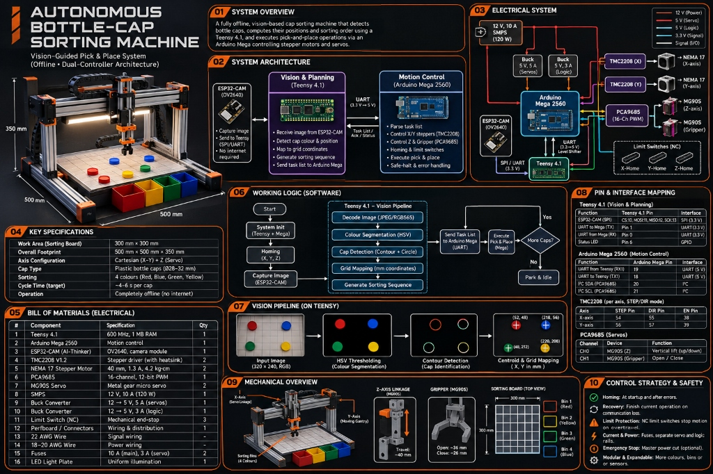

# Autonomous Bottle-Cap Sorting Machine
### Vision-Guided Pick & Place System (Offline • Dual-Controller Architecture)

**By Neil Shettigar, Kahan, and Shourya**  
*Main development & documentation by Neil Shettigar*

---



## 📌 Executive Overview

The **Autonomous Bottle-Cap Sorting Machine** is an embedded robotics project designed to detect, pick, and sort standard plastic bottle caps ($\varnothing 28\text{–}32\text{ mm}$) by colour across a $300 \times 300\text{ mm}$ grid workspace, depositing them into four designated color bins (Red, Yellow, Green, Blue).

The system operates **100% offline** without laptops, Wi-Fi, or cloud connectivity. It employs a **dual-controller architecture** that segregates high-speed edge computer vision from deterministic real-time motion control and physical safety.

---

## 🚀 Key Specifications

| Specification | Target Parameter |
| :--- | :--- |
| **Machine Envelope** | $500 \times 500 \times 500\text{ mm}$ |
| **Sorting Workspace** | $300 \times 300\text{ mm}$ (10 × 10 cells, $30\text{ mm}$ pitch) |
| **Cap Outer Diameter** | $\varnothing 28\text{–}32\text{ mm}$ standard beverage bottle caps |
| **Colours Handled** | 4 primary colours (Red, Yellow, Green, Blue) |
| **Cycle Time** | $\sim 4\text{–}6\text{ seconds}$ per cap |
| **Network Dependency** | Zero (Completely air-gapped offline edge) |
| **Primary Vision Processor** | Teensy 4.1 ($600\text{ MHz}$ ARM Cortex-M7, $1\text{ MB}$ RAM) |
| **Motion Controller** | Arduino Mega 2560 ($16\text{ MHz}$ AVR) |
| **Camera Sensor** | ESP32-CAM (AI-Thinker OV2640) |
| **Actuation** | 2× NEMA 17 Steppers (TMC2208) + 2× MG90S Servos (PCA9685) |
| **Main Power Supply** | $12\text{V}, 10\text{A}$ SMPS ($120\text{W}$) with isolated buck rails |

---

## 🧠 System Architecture & Division of Responsibilities

```
+---------------+      Wired UART (921,600 Baud)      +-------------------+
|   ESP32-CAM   | ----------------------------------> |    Teensy 4.1     |
| (Image Capture|                                     | (Vision & Planning|
|  OV2640 QVGA) | <---------------------------------- |   Cortex-M7 600M) |
+---------------+          Capture Trigger            +-------------------+
                                                                |
                                             Level-Shifted UART | Plan Packets &
                                             (115,200 Baud)     | Heartbeat
                                                                v
                                                      +-------------------+
                                                      | Arduino Mega 2560 |
                                                      | (Motion & Safety) |
                                                      +-------------------+
                                                       /        |        \
                                     STEP/DIR Pulses  /         |         \ I2C PWM
                                                     v          v          v
                                                +---------+ +-------+ +---------+
                                                | TMC2208 | | Limit | | PCA9685 |
                                                | Stepper | | Switch| | 16-Ch   |
                                                | Drivers | |  (NC) | | 12-Bit  |
                                                +---------+ +-------+ +---------+
                                                     |                     |
                                                     v                     v
                                                2x NEMA 17             2x MG90S
                                                (X & Y Gantry)       (Z & Gripper)
```

### Division of Responsibilities
1. **ESP32-CAM**: Dedicated purely to top-down frame acquisition (QVGA $320 \times 240$ RGB565). No network overhead.
2. **Teensy 4.1**: Decodes raw frame, performs fixed-point HSV color segmentation, extracts connected-component centroids, applies $3 \times 3$ planar homography for perspective distortion correction, and computes the shortest-travel sorting plan.
3. **Arduino Mega 2560**: Manages deterministic step generation, microswitch homing, 8-step pick-and-place choreography, and fail-safe state recovery.
4. **PCA9685**: Dedicated 16-channel 12-bit I2C PWM generator driving the two MG90S metal-gear micro servos (Z-axis linkage & parallel gripper jaws).
5. **TMC2208 × 2**: SilentStepStick drivers running in StealthChop2 mode for silent, resonance-free XY gantry travel.

---

## ⚡ Power Distribution Tree

- **Branch A (Motors - 12V Direct)**: Fused line feeding TMC2208 VMOT with $100\,\mu\text{F}$ low-ESR decoupling capacitors.
- **Branch B (Servos - 5V/5A Buck)**: Isolated high-current buck converter feeding PCA9685 V+ to absorb servo stall current spikes without pulling down logic.
- **Branch C (Logic - 5V/3A Buck)**: Regulated clean 5V line powering Mega, Teensy 4.1 VIN, ESP32-CAM, and PCA9685 VCC.
- **Level Shifter**: Bidirectional logic shifter installed between Arduino Mega 5V TX1 and Teensy 4.1 3.3V RX1.

---

## 🛡️ Fail-Safe Comms Recovery Protocol

If UART communication between Teensy and Mega is severed while carrying a cap:
1. The Mega **completes depositing the in-flight cap** into its locally stored assigned bin.
2. The Z-axis is safely retracted to height $0\text{ mm}$.
3. The Mega halts starting new pickups, moves to safe standby coordinates, and waits for reconnection.

---

## 💻 Web Presentation & Live Interactive Simulator

The repository includes a standalone, zero-dependency engineering web application:
- **Interactive 2D Gantry Simulator**: Place and remove bottle caps on a virtual $10 \times 10$ board, click "Start Autonomous Sort", and test communication interruption recovery.
- **Master Poster Pan & Zoom Lightbox**: Inspect high-resolution system diagrams.
- **Searchable Pinout Matrix**: Filter all controller pins, logic voltages, and safety notes.
- **Interactive BOM**: Real-time filtering between owned hardware and components to purchase.
- **Firmware Code Vault**: Tabbed code templates for Teensy, Mega, ESP32-CAM, and packet protocol.

### How to Run Locally
Simply open `index.html` in any modern web browser:
```bash
# On Windows
start index.html

# Or via Python local server
python -m http.server 8000
```

---

## 👥 Credits
- **Designed & Engineered by:** Neil Shettigar, Kahan, and Shourya
- **Lead Embedded Architecture & Software:** Neil Shettigar
